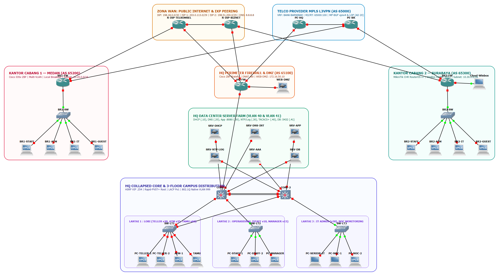

# 🏦 PT Bank Barnibar — Enterprise Multi-Site Network v4.0

### Simulasi Jaringan Perbankan Skala Nasional: HQ Jakarta + 2 Cabang Multi-Vendor
### Dual-Path WAN (MPLS L3VPN + IPsec VPN) · Zero-Downtime Failover · Zone-Based Firewall · Distributed Monitoring

[](./README.md)
[](./03-LAPORAN-UJI-DAN-JURNAL.md)
[](./03-LAPORAN-UJI-DAN-JURNAL.md)
[](./01-SRS-ARSITEKTUR-BARNIBAR.md)
[](./04-MONITORING-NOC-ZABBIX.md)
[](./02-BUKU-KERJA-IMPLEMENTASI.md)


</div>

---

## 📌 Ringkasan Proyek

Proyek ini adalah **replika digital jaringan sebuah bank nasional** yang dibangun penuh di atas **GNS3** — bukan sekadar konfigurasi di atas kertas, tapi topologi yang benar-benar dinyalakan, diuji, dan dibuktikan dengan *output* konsol asli.

Membangun jaringan untuk **kantor pusat dengan 3 lantai**, **2 kantor cabang di kota berbeda** (Medan & Surabaya) dengan **dua vendor router berbeda** (Cisco IOSv & MikroTik CHR), dihubungkan oleh **backbone MPLS L3VPN milik operator telekomunikasi**, dengan **jalur cadangan IPsec VPN** yang mengambil alih transaksi otomatis ketika kabel utama putus — **tanpa satu pun transaksi ATM yang gagal**.

> **Hasil akhir:** 41 node jaringan virtual, **9 milestone** (8 milestone inti + 1 modul observability), 45 skenario uji terima (*User Acceptance Test*), dan 12 insiden nyata yang ditelusuri sampai akar masalah lalu didokumentasikan sebagai *troubleshooting playbook*.

### Angka Kunci

| Metrik | Nilai |
|---|---|
| 🖥️ Node terpasang di GNS3 | **41 node** (Router, Switch L2/L3, Container Linux, VPCS) |
| 🏢 Lokasi tersimulasi | **3 site** (HQ Jakarta, Cabang Medan, Cabang Surabaya) |
| 🏷️ VLAN dikelola | **12 VLAN di HQ** (10/15/20/25/30/40/41/50/60/100/888/999) + **4 VLAN per cabang** |
| 🔐 Skenario uji terima | **45 test case** — 100% LULUS |
| ⚡ Waktu konvergensi failover WAN | **≈ 7 detik** (BGP timer `3/9`, tanpa intervensi NOC) |
| 📉 Downtime transaksi saat bencana | **0% packet loss** pada uji putus kabel |
| 🐛 Insiden nyata yang ditelusuri | **12 kasus** (akar masalah + solusi terdokumentasi) |
| 📊 Host dimonitor (Zabbix) | **13 host** — 5 SNMP + 8 ICMP, via proxy terdistribusi |

---

## 🗺️ Topologi Jaringan

<p align="center">
  
</p>

<p align="center"><i>Diagram lengkap: HQ dengan Collapsed Core redundan & server farm 3-tier, dua cabang multi-vendor, awan MPLS operator, serta zone firewall.</i></p>

### Penjelasan Arsitektur (4 Lapisan)

```
┌──────────────────────────────────────────────────────────────────────────┐
│  1. LAPISAN WAN — Dual Path dengan Prioritas Otomatis                    │
│     MPLS L3VPN (AS 65000) ── jalur UTAMA, rute eBGP nilai AD 20          │
│     IPsec VTI/GRE via Internet ── jalur CADANGAN, rute OSPF nilai AD 110 │
├──────────────────────────────────────────────────────────────────────────┤
│  2. LAPISAN PERIMETER — Firewall Stateful & Zona Keamanan                │
│     HQ-FW: Zone-Based Firewall (ZBF), NAT, VPN Hub, NTP Master           │
├──────────────────────────────────────────────────────────────────────────┤
│  3. LAPISAN DISTRIBUSI & AKSES — Redundansi Penuh                        │
│     CORE-1 + CORE-2: LACP Port-channel 1, HSRP Load-Sharing, Rapid-PVST+ │
│     SW-LT1/2/3: akses per lantai, Port-Security Sticky, BPDU Guard       │
├──────────────────────────────────────────────────────────────────────────┤
│  4. LAPISAN SERVER — Pemisahan Tiga Tingkat (3-Tier Isolation)           │
│     VLAN 40 (Server Farm) · VLAN 41 (Database Terisolasi) · DMZ 172.16.x │
└──────────────────────────────────────────────────────────────────────────┘
```

---

## 📚 Peta Dokumentasi

Seluruh dokumentasi disusun mengikuti **standar dokumen teknis industri** (bukan catatan belajar), sehingga bisa langsung dibaca oleh *Network Engineer*, *Auditor IT*, maupun *Engineering Manager*.

| # | Dokumen | Setara Dokumen Industri | Isi |
|---|---|---|---|
| 1 | [`01-SRS-ARSITEKTUR-BARNIBAR.md`](./01-SRS-ARSITEKTUR-BARNIBAR.md) | **SRS / HLD & LLD** | Kebutuhan bisnis bank, keputusan desain + alasannya, inventaris 41 node, Master IP & VLAN Plan, matriks kebijakan firewall, capacity planning RAM |
| 2 | [`02-BUKU-KERJA-IMPLEMENTASI.md`](./02-BUKU-KERJA-IMPLEMENTASI.md) | **NIP / Runbook** | Konfigurasi *as-built* langkah demi langkah per milestone (Cisco IOS, IOSvL2, MikroTik RouterOS v7, Docker Linux) + tabel kabel fisik |
| 3 | [`03-LAPORAN-UJI-DAN-JURNAL.md`](./03-LAPORAN-UJI-DAN-JURNAL.md) | **UAT Report + NOC Log** | 45 test case, bukti *output* konsol asli, 12 jurnal insiden (gejala → akar masalah → solusi), lembar tanda tangan serah terima |
| 4 | [`04-MONITORING-NOC-ZABBIX.md`](./04-MONITORING-NOC-ZABBIX.md) | **NMS / Observability Design** | Arsitektur Zabbix 7.0 terdistribusi (Server + Proxy), registrasi 13 host via API, desain dashboard NOC, prosedur *drill* gangguan |
| 5 | [`configs/`](./configs/) | **Configuration Baseline** | Berkas konfigurasi per perangkat (`.cfg`) — *baseline* yang bisa di-*diff* antar-versi |
| 6 | [`diagrams/`](./diagrams/) | **Network Diagram** | Diagram topologi resolusi tinggi |
| 7 | [`DOKUMENTASI-RESMI-PROYEK-v4.0-BANK-BARNIBAR.docx`](./DOKUMENTASI-RESMI-PROYEK-v4.0-BANK-BARNIBAR.docx) | **Printable / PDF-ready** | Gabungan keempat dokumen di atas dalam satu berkas Word siap cetak |

---

## 🏁 Rekapitulasi Milestone

| Milestone | Fokus Pekerjaan | Hasil Verifikasi | Tanggal |
|---|---|---|---|
| **M1** | Pondasi WAN & Dual ISP HQ (`R-ISP-TELKOMSEL`, `R-ISP-BIZNET`, peering IXP) | Ping gateway & `8.8.8.8` 100% | 2026-10-25 |
| **M2** | Collapsed Core HQ — LACP `Po1`, HSRP *Load-Sharing*, Rapid-PVST+, Native VLAN 999, Port-Security | `Po1(SU)`, STP simetris `Gi0/1`=v10/30 · `Gi0/2`=v20/50 | 2026-10-26 |
| **M3** | Layanan infrastruktur — DHCP Relay, DNS internal, NTP Master/Client, Syslog terpusat | DORA sukses, log WIB masuk `SRV-NTP-LOG` | 2026-10-26 |
| **M4** | Firewall ZBF pusat & sekat antar-divisi | Staff→Internet OK, Teller→Internet **diblokir + log** | 2026-10-27 |
| **M5** | Zona publik DMZ + isolasi Database 3-tier | DNAT ke `WEB-DMZ` sukses, `SRV-APP`→DB `:5432` OK, user→DB ditolak | 2026-10-27 |
| **M6** | Redundansi Dual ISP otomatis — IP SLA + Track + Floating Static + Route-Map NAT | Jalur pindah ke `198.51.200.2` tanpa putus | 2026-10-27 |
| **M6.5** | Gedung 3 lantai (ATM/Manager/Tamu) + server AAA TACACS+ | `senior_it` permit `conf t`, `noc_op` ditolak + terekam | 2026-10-28 |
| **M7** | Integrasi 2 cabang **multi-vendor** + Local Breakout | DHCP lokal jalan, ATM terisolasi, tamu terkurung | 2026-10-29 |
| **M8** | Backbone WAN ganda: MPLS L3VPN primary + IPsec VTI backup + uji bencana | Failover 7 detik, `0% loss`, preemption otomatis | 2026-10-30 |
| **M33** | *Bonus:* Distributed Monitoring Zabbix 7.0 (Server Proxmox + Proxy GNS3) | 13 host hijau, dashboard & map live | 2026-11-04 |

---

## 🔬 Sorotan Rekayasa (Yang Benar-Benar Dikerjakan)

### 1. Dual-Path WAN Tanpa Route-Map Rumit — Memanfaatkan *Administrative Distance*
Jalur utama adalah **eBGP** dari operator MPLS (AD **20**), jalur cadangan adalah **OSPF** di atas terowongan IPsec (AD **110**). Karena BGP selalu menang, router **tidak perlu** konfigurasi *preference* buatan: begitu link Telco mati, rute BGP ditarik dan OSPF otomatis naik jadi jalur aktif.

```text
BR2-IT> trace 10.10.40.50 -P 1
 1   10.30.30.1   2.021 ms
 2   10.254.2.1   6.511 ms   ← jalur utama: PE Telco (AD 20)
 3   10.254.0.1   5.396 ms
 4   10.10.40.50  8.687 ms   ← Server Core Banking Jakarta

HQ-FW(config)# interface GigabitEthernet0/3
HQ-FW(config-if)# shutdown      ! bencana: kabel fiber Telco putus

BR2-IT> trace 10.10.40.50 -P 1
 1   10.30.30.1   1.041 ms
 2   10.255.2.1  11.309 ms   ← otomatis lompat ke IPsec VTI (AD 110)
 3   10.10.40.50 16.108 ms   ← transaksi tetap jalan, loss 0%
```

### 2. Tuning Timer BGP untuk Lingkungan Finansial
Standar BGP (keepalive 60s / holdtime 180s) terlalu lambat untuk transaksi bank. Diubah menjadi `timers bgp 3 9` + `neighbor advertisement-interval 0` pada seluruh PE dan CE → deteksi link putus ≈ **9 detik**, dan uji nyata menunjukkan peralihan total **≈ 7 detik**.

### 3. Redundansi Gateway yang Simetris (Bukan Sekadar "Ada Dua Switch")
HSRP dan STP sengaja **diselaraskan**: `CORE-1` aktif untuk VLAN 10/30, `CORE-2` aktif untuk VLAN 20/50 — sehingga kedua kabel uplink dari access switch benar-benar terpakai, bukan satu jadi cadangan menganggur.

```text
SW-LT1# show interfaces trunk
Port     Mode   Encapsulation  Status    Native vlan
Gi0/1    on     802.1q         trunking  999
Gi0/2    on     802.1q         trunking  999

Gi0/1    10,30              ← aktif lewat CORE-1
Gi0/2    1,20,50,888,999    ← aktif lewat CORE-2
```

### 4. Keamanan Berlapis: Pengguna Tidak Boleh Menyentuh Database
Tiga lapis pertahanan yang masing-masing diuji terpisah:

| Lapis | Mekanisme | Bukti |
|---|---|---|
| L2/L3 | ACL isolasi antar-VLAN di switch core | `ICMP type:3, code:13 (administratively prohibited)` |
| L4 | Zone-Based Firewall *stateful* di perimeter | `%FW-6-DROP_PKT ... ZP-BLOKIR-USER-KE-DB` |
| Arsitektur | Database di VLAN 41 terpisah dari server farm | Hanya `SRV-APP`/`WEB-DMZ` yang punya izin `TCP 5432` |

### 5. Multi-Vendor Interoperability (Cisco ⇄ MikroTik)
Cabang Medan memakai **Cisco IOSv**, Cabang Surabaya memakai **MikroTik RouterOS v7**. Keduanya harus bicara OSPF dan IPsec dengan router pusat Cisco — termasuk menyamakan proposal enkripsi (`aes-256 / sha256 / modp2048`) dan mengatasi perbedaan struktur perintah OSPF di RouterOS v7 (`instance`, `area`, `interface-template`).

### 6. Isolasi Berbasis Peran, Bukan Sekadar VLAN
- **Kasir (Teller):** hanya boleh membuka aplikasi transaksi `TCP 8080`. Internet diblokir mutlak + dicatat.
- **Karyawan:** boleh intranet `:80` dan internet, **tidak boleh** `:8080`.
- **Mesin ATM:** terkurung total dari internet, baik di HQ maupun di cabang.
- **Wi-Fi Tamu:** hanya *local breakout* ke internet, nol akses ke jaringan bank.
- **Admin:** `TACACS+` memisahkan `senior_it` (privilege 15) dan `noc_op` (read-only) — setiap perintah terekam.

---

## 📊 Observability: NOC dalam Satu Layar

Monitoring bukan tempelan — dibangun dengan arsitektur **distributed monitoring** yang lazim di enterprise: **Zabbix Server** di Proxmox LXC + **Zabbix Proxy** di jaringan lab, sehingga perangkat di balik NAT tetap terpantau tanpa membuka port SNMP ke publik.

```text
Zabbix Server 7.0 LTS (Proxmox LXC)          Zabbix Proxy (Docker di GNS3 VM)
  192.168.18.50  ◄──── TCP 10051 ────────   192.168.65.128
        │                                          │
   Web GUI · Dashboard NOC · Alerting         SNMPv2c UDP 161 + ICMP
                                                    │
                        ┌───────────────────────────┴─────────────────────┐
                  5 perangkat jaringan                            8 server & link
                  (Cisco + MikroTik)                              (ICMP + service)
```

**Hasil:** 13 host terdaftar, 5 perangkat SNMP berstatus *Available*, dashboard operasional 2 halaman + peta topologi interaktif. Detail lengkap di [`04-MONITORING-NOC-ZABBIX.md`](./04-MONITORING-NOC-ZABBIX.md).

---

## 🧰 Teknologi yang Digunakan

| Kategori | Teknologi |
|---|---|
| **Emulator** | GNS3 2.2.61 + GNS3 VM (VMware Workstation), QEMU |
| **Router / Firewall** | Cisco IOSv 15.9(3)M6, MikroTik RouterOS CHR v7 |
| **Switch Layer-2/3** | Cisco IOSvL2 |
| **Server & Layanan** | Docker di GNS3 VM — `isc-dhcp-server`, `dnsmasq`, `rsyslog`, `nginx`, `PostgreSQL`, `tac_plus` |
| **End Device** | VPCS |
| **Routing** | OSPF Area 0, eBGP, MP-BGP `vpnv4`, MPLS LDP, VRF (RD/RT) |
| **VPN** | IPsec IKEv2 VTI (Cisco↔Cisco), GRE-IPsec (Cisco↔MikroTik) |
| **Keamanan** | Zone-Based Firewall, ACL, Port-Security, DHCP Snooping, BPDU Guard, TACACS+ |
| **HA** | LACP, HSRP, Rapid-PVST+, IP SLA + Object Tracking |
| **Monitoring** | Zabbix 7.0 LTS + Zabbix Proxy, SNMPv2c, ICMP |
| **Otomasi** | Python + Zabbix JSON-RPC API (registrasi host & dashboard otomatis) |

---

## 📁 Struktur Repositori

```text
PROYEK-v4.0-BANK-BARNIBAR/
├── README.md                          ← Anda di sini (ringkasan & showcase)
├── 01-SRS-ARSITEKTUR-BARNIBAR.md      ← SRS / HLD & LLD
├── 02-BUKU-KERJA-IMPLEMENTASI.md      ← Runbook konfigurasi as-built
├── 03-LAPORAN-UJI-DAN-JURNAL.md       ← UAT + jurnal troubleshooting
├── 04-MONITORING-NOC-ZABBIX.md        ← Desain monitoring & observability
├── DOKUMENTASI-RESMI-...-BARNIBAR.docx ← Ekspor Word gabungan (versi cetak/PDF-ready)
├── CHANGELOG.md                       ← Riwayat perubahan dokumentasi
├── LICENSE                            ← MIT
├── .gitignore                         ← Pengecualian file besar & kredensial
├── configs/                           ← Baseline konfigurasi per perangkat
│   ├── README.md                      ← Indeks & konvensi penulisan
│   ├── HQ-FW.cfg
│   ├── CORE-1.cfg
│   ├── CORE-2.cfg
│   ├── SW-LT1.cfg
│   ├── R-ISP-TELKOMSEL.cfg
│   ├── R-ISP-BIZNET.cfg
│   └── SRV-DHCP.md · SRV-DNS-INT.md
└── diagrams/
    └── topologi-bank-barnibar-v4.png
```

> **Catatan:** file proyek GNS3 (`.gns3`) dan image QEMU (`.qcow2`) **tidak** disimpan di repositori karena berukuran besar — repositori ini fokus pada **dokumentasi dan konfigurasi**.

---


